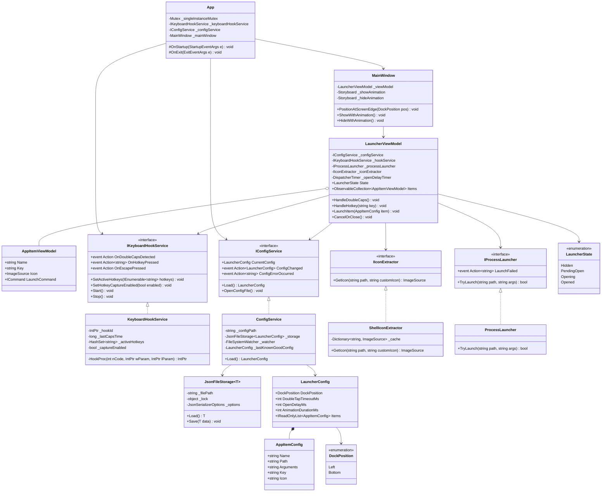

# [RFC] CapsCaps: Всплывающая панель быстрого запуска по двойному Caps Lock

## 1. Резюме решений

* **Проблема:** Необходим быстрый вызов панели ярлыков и мгновенный запуск приложений по горячим клавишам без лишних визуальных переключений.
* **Границы задачи (Scope):**
  * Перехват двойного нажатия Caps Lock (дельта $\le 300$ мс) через глобальный Win32 хук `WH_KEYBOARD_LL`. Caps Lock сохраняет штатное поведение в ОС.
  * **Единый цикл открытия и быстрый перехват хоткеев:**
    * Двойной Caps Lock всегда запускает единый процесс отображения: таймер задержки (200–300 мс) $\to$ плавная анимация появления (150–200 мс).
    * Нажатие хоткея любого из приложений в любой момент (во время ожидания, анимации или в открытом состоянии) запускает приложение и мгновенно отменяет открытие / закрывает панель.
    * Если пользователь нажал хоткей во время задержки (200–300 мс), окно вовсе не успевает отрисоваться (нулевое мерцание).
    * **Подавление ввода хоткея:** хук поглощает нажатие зарегистрированного хоткея (возвращает `1`), предотвращая случайную печать символа в активный текстовый редактор или браузер.
    * **Независимость от раскладки:** клавиши матчатся по физическим Virtual Key Codes (`VK_A`–`VK_Z`, `VK_0`–`VK_9`), работая одинаково в RU и EN раскладках.
    * **Повторные нажатия Caps Lock:** при открывающейся или открытой панели повторные нажатия Caps Lock игнорируются. Закрытие происходит строго по `Escape`, клику вне панели или выбору ярлыка.
  * **Компактный дизайн дока (иконки 48px с угловыми бейджами):**
    * Плитки приложений без сплошных фоновых плашек: крупная иконка $48 \times 48$ px, компактная подпись снизу и стильный бейдж с хоткеем в правом верхнем углу иконки.
    * Ширина вертикального дока сокращена до ~84 px (минимальное перекрытие экрана), а в горизонтальном режиме образует аккуратный плавающий остров.
  * **Позиционирование и сеточный перенос (Wrap Layout):**
    * Позиционирование дока настраивается (`dockPosition`: `Left`, `Right`, `Top`, `Bottom`) на мониторе, где находится курсор мыши.
    * Ориентация размещения (`layoutOrientation`: `Vertical` / `Horizontal`) и лимит элементов в линии (`maxItemsPerLine`). При превышении лимита элементы переносятся в следующий столбец или строку.
  * **Запуск от администратора:** поддержка свойства `runAsAdmin: true` в элементе конфига (запуск через `Verb = "runas"`).
  * **Поддержка URL, протоколов и папок:** запуск веб-ссылок (`https://...`), системных протоколов (`ms-settings:...`) и папок через единый механизм `UseShellExecute = true`.
  * **Игнорирование в полноэкранных приложениях:** проверка активного окна на Exclusive Fullscreen (игры, видеоплееры) для предотвращения сворачивания и сбоев DirectX.
  * Автоматическое извлечение иконок из `.exe` / `.lnk` через Win32 Shell API (`SHGetFileInfo` / `ExtractIconEx`) с возможностью переопределения пользовательской картинкой.
  * Управление фоновым процессом: `Mutex` (Single Instance) + системный трей (NotifyIcon) с пунктами «Открыть config.json», переключателем «Запускать при старте Windows» (реестр `HKCU\...\Run`) и «Выход».
  * Источник конфигурации — `config.json` рядом с `.exe` на базе потокобезопасного `JsonFileStorage<T>` (из QuietShell) с поддержкой Hot Reload (`FileSystemWatcher`) и защитой Last Known Good Configuration.
  * **Переиспользование из QuietShell:** полезные общие утилиты (включая `JsonFileStorage<T>`, работу с файлами и базовые UI-классы) копируются напрямую из проектов `QuietShell.Shared` и `QuietShell.Shared.UI` целиком без изменений. Для них в решении выделяется отдельный проект `CapsCaps.Shared`.
  * Интерфейс строится с использованием `ModernWpfUI` (Fluent Design, темная тема) и `H.NotifyIcon.Wpf` для системного трея (как в QuietShell.Client).
  * Автоматизированное тестирование бизнес-логики и конфига через отдельный тестовый проект `CapsCaps.Tests` (xUnit).

## 2. Контракты и схемы

### 2.1. Схема `config.json`

```json
{
  "dockPosition": "Left",
  "layoutOrientation": "Vertical",
  "maxItemsPerLine": 8,
  "doubleTapTimeoutMs": 300,
  "openDelayMs": 250,
  "animationDurationMs": 180,
  "items": [
    {
      "name": "Блокнот",
      "path": "notepad.exe",
      "arguments": "",
      "key": "N",
      "icon": "",
      "runAsAdmin": false
    },
    {
      "name": "Калькулятор",
      "path": "calc.exe",
      "arguments": "",
      "key": "C",
      "icon": "",
      "runAsAdmin": false
    },
    {
      "name": "Проводник",
      "path": "explorer.exe",
      "arguments": "",
      "key": "E",
      "icon": "",
      "runAsAdmin": false
    },
    {
      "name": "Терминал",
      "path": "wt.exe",
      "arguments": "",
      "key": "T",
      "icon": "",
      "runAsAdmin": true
    }
  ]
}
```

### 2.2. Внутренние модели данных (C#)

```csharp
namespace CapsCaps.Models;

public enum DockPosition {

    Left,
    Right,
    Top,
    Bottom,
}

public enum LayoutOrientation {

    Vertical,
    Horizontal,
}

public sealed record AppItemConfig(
    string Name,
    string Path,
    string? Arguments,
    string? Key,
    string? Icon,
    bool RunAsAdmin = false,
);

public sealed record LauncherConfig(
    DockPosition DockPosition,
    LayoutOrientation LayoutOrientation,
    int MaxItemsPerLine,
    int DoubleTapTimeoutMs,
    int OpenDelayMs,
    int AnimationDurationMs,
    IReadOnlyList<AppItemConfig> Items,
);
```

### 2.3. Контракт жизненного цикла панели и хука

```csharp
namespace CapsCaps.Services;

public enum LauncherState {

    Hidden,
    PendingOpen, // Идет задержка 200–300 мс перед появлением
    Opening,     // Воспроизводится анимация появления (150–200 мс)
    Opened,      // Панель полностью открыта и ожидает действий
}

public interface IKeyboardHookService : IDisposable {

    event Action? OnDoubleCapsDetected;
    event Action<string>? OnHotkeyPressed;
    event Action? OnEscapePressed;

    void SetActiveHotkeys(IEnumerable<string> hotkeys);
    void SetHotkeyCaptureEnabled(bool enabled);
    void Start();
    void Stop();
}
```

### 2.4. Диаграмма классов (Class Diagram)



## 3. Обработка краевых случаев и отказов

* **Повторный запуск процесса:**  
  Именованный мьютекс `Global\CapsCaps_App_SingleInstance_Mutex`. При обнаружении второго экземпляра выводится уведомление (или активируется первый экземпляр), а второй процесс мгновенно завершается (`Application.Current.Shutdown()`).
* **Отсутствие `config.json`:**  
  При первом старте генерируется валидный дефолтный `config.json` со стандартными приложениями Windows (Блокнот, Калькулятор, Проводник, Терминал).
* **Синтаксическая ошибка в `config.json`:**  
  Файл на диске **не перезаписывается**. Показывается всплывающее системное уведомление («Ошибка синтаксиса в config.json: <сообщение>»). Приложение продолжает работать на последней успешной конфигурации в памяти (Last Known Good Config).
* **Недоступный путь к приложению:**  
  При клике или нажатии клавиши запуск оборачивается в `try/catch`. При `Win32Exception` или `FileNotFoundException` панель скрывается, а пользователю выводится всплывающее уведомление с текстом ошибки (без крэша приложения).
* **Многомониторная конфигурация и разное DPI:**  
  Координаты курсора запрашиваются через `GetCursorPos`, через WinForms `Screen.FromPoint` находится целевой экран и его рабочая область (`WorkingArea`). Окно позиционируется строго у границы соответствующего монитора с учётом DPI-масштабирования.
* **Полноэкранные приложения и игры (Exclusive Fullscreen):**  
  Перед запуском цикла открытия проверяется хендл активного окна (`GetForegroundWindow`). Если окно занимает весь экран и перекрывает панель задач (характерно для 3D-игр и медиаплееров), событие Caps Lock игнорируется, предотвращая сбои DirectX и нежелательное сворачивание игры.
* **Подавление хоткеев (Key Suppression):**  
  Если лаунчер находится в состоянии `PendingOpen`, `Opening` или `Opened`, нажатие зарегистрированного хоткея перехватывается, и хук возвращает `(IntPtr)1`. Это блокирует дальнейшую передачу нажатия в систему и защищает от ввода паразитных символов в текстовый редактор или браузер.
* **Повторные нажатия Caps Lock:**  
  Если окно уже открывается или открыто, любые последующие нажатия Caps Lock игнорируются (без переключения состояний панели). Закрытие выполняется строго по `Escape`, потере фокуса (`Deactivated`) или клику/хоткею запуска.
* **Запуск с повышением привилегий (Run As Administrator):**  
  Если в элементе конфига указано `"runAsAdmin": true`, запуск процесса осуществляется с `ProcessStartInfo.Verb = "runas"`. В случае отказа пользователя в системном окне UAC исключение перехватывается, а пользователю выводится уведомление об отмене.
* **Таймаут низкоуровневого хука Windows:**  
  Вся обработка в функции хука `LowLevelKeyboardProc` сводится к проверке виртуального кода клавиши и фиксации таймштампа (`Environment.TickCount64`). Вся работа с UI и таймерами делегируется асинхронно через `Dispatcher`, что исключает зависание и удаление хука системой.

## 4. Пошаговый план реализации (Вертикальные срезы)

### Этап 1: Инфраструктура и каркас

1. [ ] **Шаг 1: Добавить зависимости**
   * Подключить `ModernWpfUI` (0.9.6) и `H.NotifyIcon.Wpf` (2.4.1) в `CapsCaps.csproj`.
2. [ ] **Шаг 2: Добавить пустой проект с тестами**
   * Создать проект `CapsCaps.Tests` (xUnit, .NET 8) и добавить в `CapsCaps.sln`.
3. [ ] **Шаг 3: Добавить пустой утилитный проект**
   * Создать библиотечный проект `CapsCaps.Shared` (.NET 8) и добавить в решение.
4. [ ] **Шаг 4: Скопировать необходимые утилиты в CapsCaps.Shared**
   * Перенести `JsonFileStorage<T>` и `DataProtection` из `QuietShell.Shared`.
   * Перенести `BaseViewModel`, `IViewModel` и `DialogService` из `QuietShell.Shared.UI`.

### Этап 2: Базовое окно и управление процессом

1. [ ] **Шаг 5: Пустое фоновое приложение с треем**
   * Реализовать `TrayService` по паттерну из `QuietShell.Client` (`[RelayCommand] ExitApplication`, управление `TaskbarIcon`).
   * Настроить `App.xaml` и `App.xaml.cs`: скрытие из панели задач/Alt-Tab, иконка в трее через `H.NotifyIcon.Wpf` с пунктом меню «Выход».
2. [ ] **Шаг 6: Каркас окна панели (статичное отображение)**
   * Сверстать базовое безрамочное окно `MainWindow.xaml` (фиксированный размер, темный фон ModernWPF, пока видна всегда для отладки).
3. [ ] **Шаг 7: Хоткей Caps-Caps и базовое закрытие**
   * Реализовать перехват двойного Caps Lock через `WH_KEYBOARD_LL`.
   * Показ окна по хоткею, скрытие по `Escape` и потере фокуса (`Deactivated`).

### Этап 3: Анимации и тайминги

1. [ ] **Шаг 8: Плавная анимация появления и скрытия**
   * Добавить анимацию выезда (Slide-in) и прозрачности (Fade-in) для окна у края экрана.
2. [ ] **Шаг 9: Задержка открытия (PendingOpen) и ранняя отмена**
   * Добавить таймер задержки открытия (250 мс) перед запуском анимации. Отмена по `Escape` во время задержки без отображения окна.

### Этап 4: Конфигурация и данные

1. [ ] **Шаг 10: Модели данных и первичное чтение config.json**
    * Реализовать модели `LauncherConfig`, `AppItemConfig`, `DockPosition`, `LayoutOrientation`.
    * Чтение `config.json` через `JsonFileStorage`, автогенерация дефолтного файла при первом старте. Юнит-тесты на парсер.
2. [ ] **Шаг 11: Отказоустойчивость (Last Known Good Config) и Hot Reload**
    * Интеграция `FileSystemWatcher` на `config.json`.
    * Сохранение последней валидной конфигурации при ошибке парсинга, всплывающее уведомление об ошибке. Юнит-тесты.

### Этап 5: UI элементов и извлечение иконок

1. [ ] **Шаг 12: Статичная верстка элементов списка панели**
    * Сверстать карточки приложений в панели: название, слот под иконку, бейдж горячей клавиши `[N]`, ховер-эффекты ModernWPF.
2. [ ] **Шаг 13: Динамический биндинг списка из config.json**
    * Связать `ObservableCollection` во ViewModel с данными из `ConfigService`, обновление списка при Hot Reload.
3. [ ] **Шаг 14: Извлечение нативных иконок (ShellIconExtractor)**
    * Реализовать извлечение иконок через `SHGetFileInfo` / `ExtractIconEx` с кэшированием и поддержкой переопределения пользовательской картинкой.

### Этап 6: Запуск и хоткеи

1. [ ] **Шаг 15: Запуск приложений по клику мыши**
    * Реализовать `ProcessLauncher`: запуск `.exe`, URL (`https://...`), системных протоколов (`ms-settings:`) и папок. Скрытие панели после клика, обработка ошибок без падений.
2. [ ] **Шаг 16: Запуск по хоткею из открытой панели**
    * Перехват нажатия клавиши `key` при открытой панели: подавление ввода символа в активное окно, запуск приложения, закрытие панели.
3. [ ] **Шаг 17: Быстрый аккорд (запуск во время задержки PendingOpen)**
    * Если клавиша `key` нажата во время таймера 250 мс: запуск процесса и мгновенная отмена открытия окна (нулевое мерцание).

### Этап 7: Дополнительные системные требования и шлифовка

1. [ ] **Шаг 18: Настройка геометрии и перенос (Wrap Layout)**
    * Поддержка `dockPosition` (Left, Right, Top, Bottom), `layoutOrientation` (Vertical, Horizontal) и перенос строк/колонок по `maxItemsPerLine`.
2. [ ] **Шаг 19: Запуск от имени администратора**
    * Поддержка свойства `runAsAdmin: true` в конфиге (запуск с `Verb = "runas"`), обработка отказа UAC.
3. [ ] **Шаг 20: Игнорирование в полноэкранных приложениях/играх**
    * Проверка `GetForegroundWindow` на Exclusive Fullscreen режим перед запуском конвейера открытия.
4. [ ] **Шаг 21: Предотвращение дубликатов процесса (Single Instance)**
    * Именованный `Mutex` в `App.xaml.cs`, мгновенное тихое завершение второго экземпляра.
5. [ ] **Шаг 22: Автозапуск вместе с Windows**
    * Чекбокс в меню системного трея «Запускать при старте Windows», запись ключа в `HKCU\Software\Microsoft\Windows\CurrentVersion\Run`.

## 5. Стратегия верификации

* **Автотесты:** `dotnet test` в корне решения (проверка парсера конфига, Last Known Good Config, генерации шаблона и логики аккордов).
* **Компиляция:** `dotnet build` в `P:\RiderProjects\CapsCaps`.
* **Сценарий 1 (Двойной клик Caps Lock):** два нажатия подряд открывают панель у левого/нижнего края текущего монитора.
* **Сценарий 2 (Быстрый аккорд):** двойной Caps Lock + моментальное нажатие буквы запускает приложение без отображения панели.
* **Сценарий 3 (Автозакрытие):** клик мышью вне панели или нажатие Escape мгновенно скрывает панель.
* **Сценарий 4 (Hot Reload):** изменение порядка или названий в `config.json` сразу применяется к следующему открытию панели без перезапуска процесса.
* **Сценарий 5 (Ошибки):** ввод некорректного JSON или битого пути к exe не приводит к аварийному завершению приложения.
